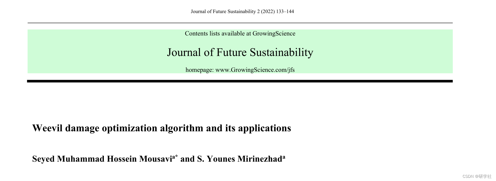
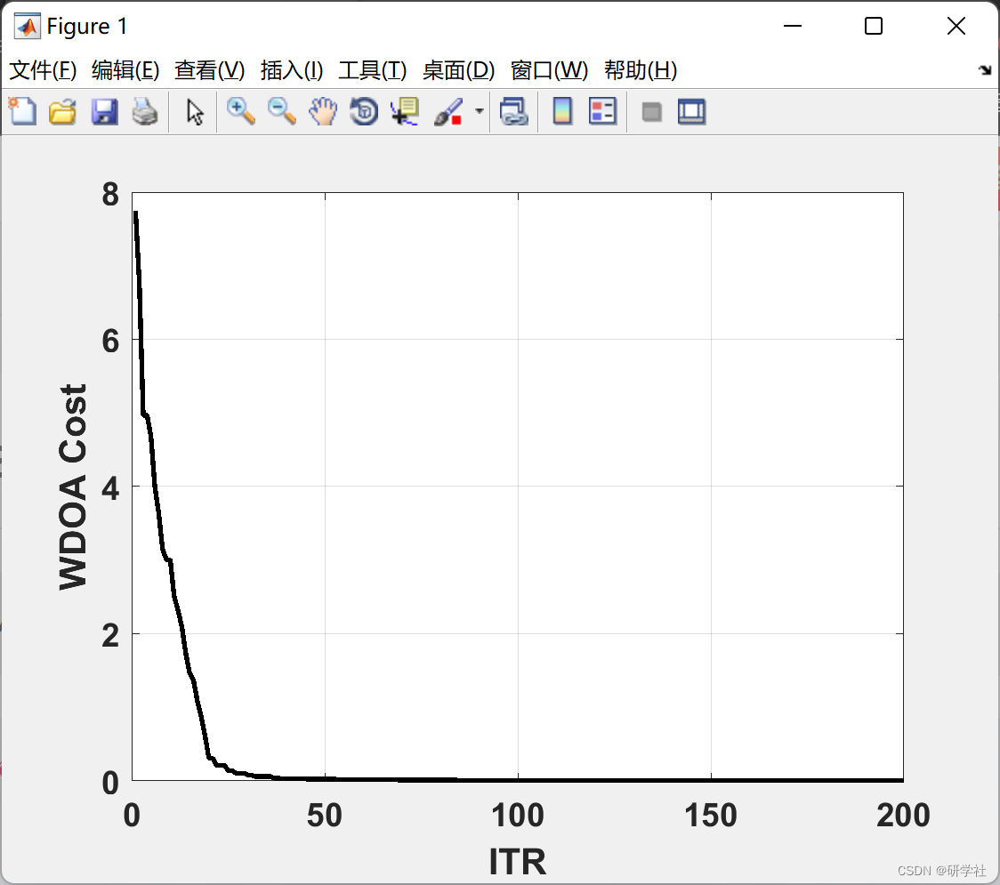
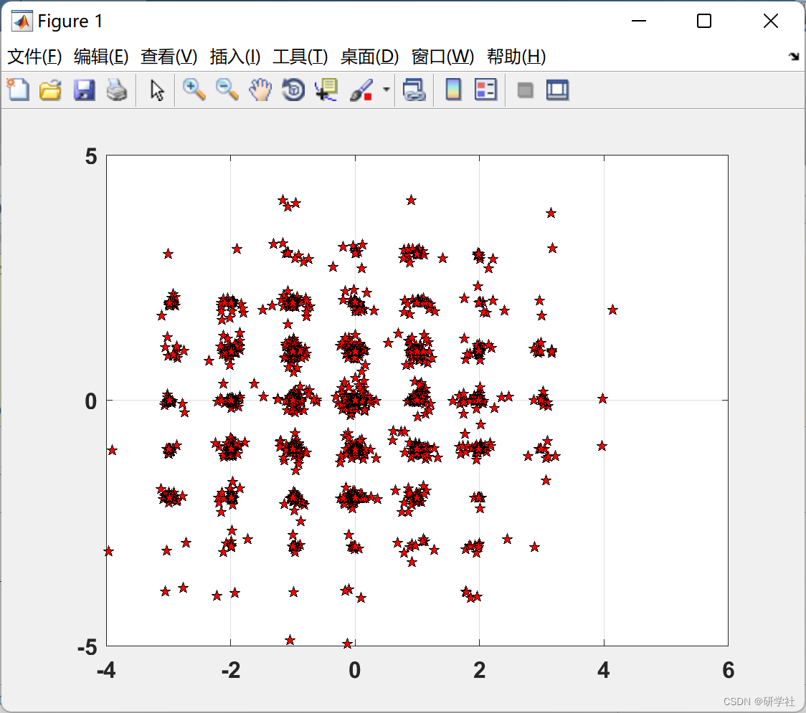
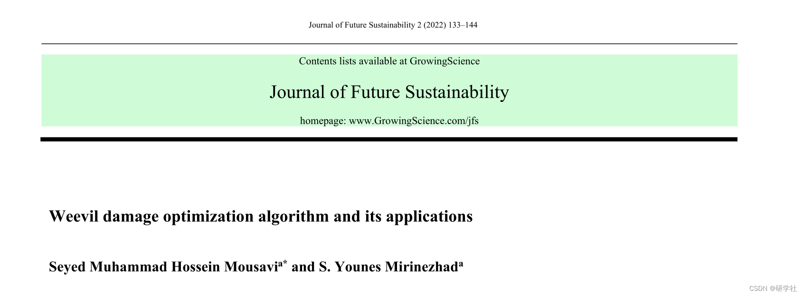

# Optimization Algorithm for Pest Infestation Reduction (Matlab Code Implementation)

🏆 Bloggers' Advantage: 🌞🌞🌞 The content of the blog strives to be rigorous in thought and clear in logic, for the convenience of readers.
⛳️ Mantra: "Those who have traveled a hundred miles, are only half way to the end." 📜
Editor
The anteater is an insect with a long, thin nose, belonging to the Curculionoide superfamily and comprising approximately 97,000 species. Most of these insects are considered pests that cause environmental damage. However, some species, such as wheat anteaters, corn anteaters, and cotton boll ants, are notorious for their devastating impact on crops, especially grains. This study introduces a new group-based metaheuristic algorithm called the Anteater Disruption Optimization Algorithm (WDOA), which simulates the flight capabilities, nose strength, and damage abilities of anteaters towards crops or agricultural products. The proposed algorithm was tested using 12 benchmark unimodal and multimodal artificial landscapes or optimization test functions. Additionally, the proposed WDOA was applied to five engineering problems to assess its robustness in solving them. The problems included the Traveling Salesman Problem (TSP), n-Queens problem, portfolio problem, optimal inventory control problem (OIC), and box packing problem (BPP). All tested functions were compared with widely used benchmark algorithms such as Particle Swarm Optimization (PSO), Genetic Algorithm (GA), Coalition Search (HS) algorithm, Imperial Competitive Algorithm (ICA), Firefly Algorithm (FA), and Differential Evolution (DE) algorithm. Furthermore, all problems were tested using DE, FA, and HS algorithms, where the proposed algorithm demonstrated robustness and speed across all functions and problems by providing both precision and reasonable speed.
📚2 Running Results Editing
Editor
Part of the code:
%% Begin  
clc;  
clear;  
close all;  
warning ('off');  
%%-----------------------------------------  
% You can define the cost fucntion here.  
% 1.Ackley, 2.Beale, 3.Bird, 4.Booth, 5.Dejong,  
% 6.Easom, 7.Eggholder, 8.Levy, 9.Matyas, 10.Michalewicz  
% 11.Rastrigin, 12.Rosenbrock, 13.Schwefel, 14.Sphere  
CostFunction = @(x) Ackley(x);    % Cost Function  
tic  
%%-----------------------------------------  
nVar = 10;              % Number of Decision Variables  
VarSize = [1 nVar];         % Decision Variables Matrix Size  
VarMin = -5;             % Decision Variables Lower Bound  
VarMax = 5;             % Decision Variables Upper Bound  
%% WDOA Parameters  
MaxIt = 200;            % Maximum Number of Iterations  
nPop = 30;             % Number of weevils  
DamageRate = 0.3;         % Damage Rate  
nweevil = round(DamageRate*nPop); % Number of Remained weevils  
nNew = nPop-nweevil;        % Number of New weevils  
mu = linspace(1, 0, nPop);     % Mutation Rates  
pMutation = 0.1;          % Mutation Probability  
MUtwo = 1-mu;           % Second Mutation  
SnoutPower = 0.8;         % Weevil Snout power Rate  
FlyPower = 0.03*(VarMax-VarMin);  % Weevil Fly Power Rate  
%----------------------------------------  
%% Basics  
% Empty weevil  
weevil.Position = [];  
weevil.Cost = [];  
% Weevils Array  
pop = repmat(weevil, nPop, 1);  
% First weevils  
for i = 1:nPop  
pop(i).Position = unifrnd(VarMin, VarMax, VarSize);  
pop(i).Cost = CostFunction(pop(i).Position);  
end;  
% Sort  
[~, SortOrder] = sort([pop.Cost]);pop = pop(SortOrder);  
% Best Solution  
BestSol = pop(1);  
% Best Costs Array  
BestCost = zeros(MaxIt, 1);  
%--------------------------------  
%% WDOA Body  
for it = 1:MaxIt  
newpop = pop;  
for i = 1:nPop  
for k = 1:nVar  
if rand <= MUtwo(i)  
TMP = mu;TMP(i) = 0;TMP = TMP/sum(TMP);  
j = RouletteWheelS(TMP);  
newpop(i).Position(k) = pop(i).Position(k)+SnoutPower*(pop(j).Position(k)-pop(i).Position(k));  
end;  
% Mutation  
if rand <= pMutation  
newpop(i).Position(k) = newpop(i).Position(k)+FlyPower*randn;  
end;end;  
% Apply Lower and Upper Bound Limits  
newpop(i).Position = max(newpop(i).Position, VarMin);  
newpop(i).Position = min(newpop(i).Position, VarMax);  
newpop(i).Cost = CostFunction(newpop(i).Position);end;% Asses power  
[~, SortOrder] = sort([newpop.Cost]);newpop = newpop(SortOrder);% Sort  
pop = [pop(1:nweevil);newpop(1:nNew)];% Select  
[~, SortOrder] = sort([pop.Cost]);pop = pop(SortOrder);% Sort  
BestSol = pop(1);% Update  
BestCost(it) = BestSol.Cost;% Store  
🎉3 References
🌈4 Matlab Code and Article Reading

## Images

<!-- PAYMENT_BLOCK -->

## Get this dataset

- Payment link (Stripe): [Buy now](https://buy.stripe.com/3cs8yP7sY87d0vu9AB)
- Payment QR code: 

<!-- /PAYMENT_BLOCK -->
